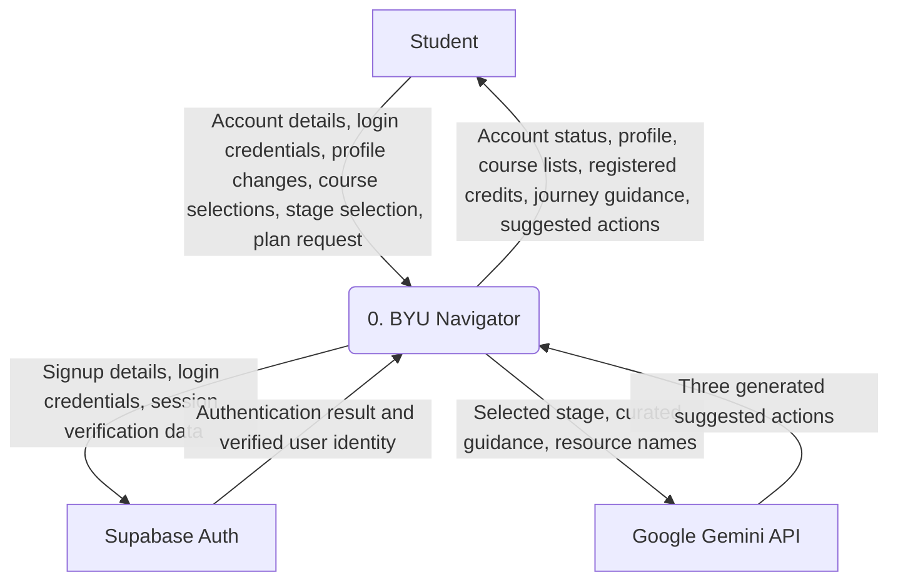
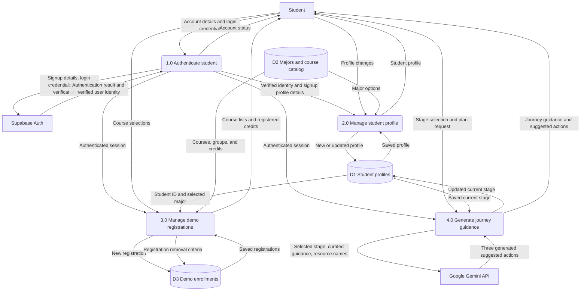

# BYU Navigator

## App Summary

Newly admitted international students at BYU have to piece together information about applying, housing, classes, work, and taxes from many different offices and websites. That information is often scattered, written for students already on campus, and only available in English, which makes the transition to BYU stressful and confusing. BYU Navigator is a central hub that guides international students through each stage of their BYU experience, from applying all the way to graduation. Students create an account with their NetID, follow a step-by-step journey map with action items and official resources for each stage, and can ask a built-in assistant questions along the way. The app also supports multiple languages so students can read guidance in the language they're most comfortable with. Our goal is to help international students feel prepared and less overwhelmed, one step at a time.

## ERD


## Data Flow Diagrams

These diagrams show account access, student profiles, simulated course
registrations, saved journey stages, and AI-generated next steps.
Course registrations are simulations for Demo Term.

### Level 0 — Context Diagram

The entire application is represented as one process. Supabase Auth
and Google Gemini are external services. Internal database tables
are shown in Level 1.



### Level 1 — Main Processes

The application is divided into four processes. Database tables are
shown as logical data stores, even though Supabase hosts them.
The AI journey process runs through a Vercel backend function.



The AI workflow uses the student's saved stage to generate suggestions.
It sends stage guidance and resource names to Gemini, rather than
student names, email addresses, or passwords. Official resource links
come from the application's curated list.

## Tech Stack

| Layer | Technology |
|-------|------------|
| Frontend | HTML, CSS, and JavaScript |
| Backend | Supabase (backend as a service) |
| Database | PostgreSQL, hosted by Supabase |
| Hosting | opened locally in the browser |

**Why we chose this:** We chose Supabase because it gives us a real PostgreSQL database without having to build and host our own server. Its Table Editor lets everyone on the team see and edit our tables directly, which made it easy to check that our button was actually saving data. It also has a free tier and a JavaScript library that connects straight from our frontend, which kept setup simple for a team with mixed experience.

## How to Get It Running
1. Clone the repository:
```
   git clone https://github.com/msaku3/byu-navigator.git
   cd byu-navigator
```
2. Create a `.env` file in the project root with:
```
   SUPABASE_URL=your_project_url
   SUPABASE_ANON_KEY=your_anon_key
```
This file is listed in `.gitignore` and is not in the repo. Ask a team member for the values, or find them in Supabase under **Project Settings → API**.
3. The database tables and sample data already live in our Supabase project, so no database setup is needed.
4. Open `BYU Navigator – Prototype.html` in Google Chrome.
