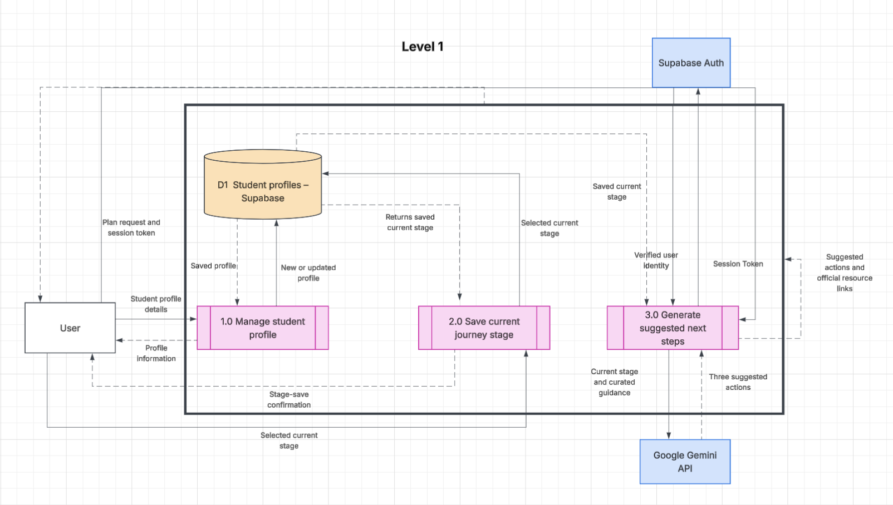

# BYU Navigator

## App Summary

Newly admitted international students at BYU have to piece together information about applying, housing, classes, work, and taxes from many different offices and websites. That information is often scattered, written for students already on campus, and only available in English, which makes the transition to BYU stressful and confusing. BYU Navigator is a central hub that guides international students through each stage of their BYU experience, from applying all the way to graduation. Students create an account with their email address and password, follow a step-by-step journey map with action items and official resources for each stage, and can ask a built-in assistant questions along the way. Students can also generate three AI-powered suggested next steps based on their saved current journey stage. The app also supports multiple languages so students can read guidance in the language they're most comfortable with. Our goal is to help international students feel prepared and less overwhelmed, one step at a time.

## ERD


### Level 1 — Student Profile and AI Journey Workflow



## Tech Stack

| Layer | Technology |
|-------|------------|
| Frontend | HTML, CSS, and JavaScript |
| Backend | Supabase (backend as a service) and Vercel Functions |
| Authentication | Supabase Auth |
| AI service | Google Gemini API |
| Database | PostgreSQL, hosted by Supabase |
| Hosting | Vercel — [Live website](https://byu-navigator.vercel.app/) |

**Why we chose this:** We chose Supabase because it gives us a real PostgreSQL database without having to manage our own database server. Its Table Editor lets everyone on the team see and edit our tables directly, which made it easy to check that our button was actually saving data. It also has a free tier and a JavaScript library that connects straight from our frontend, which kept setup simple for a team with mixed experience.

## How to Get It Running

Install Node.js 22 or later and Git before starting. To try the deployed app, visit [BYU Navigator](https://byu-navigator.vercel.app/).

1. Clone the repository and enter the application folder:
```
   git clone https://github.com/msaku3/byu-navigator.git
   cd byu-navigator/byu-navigator
```
2. Create a `.env` file in the application folder, beside `package.json` and `server.js`, with:
```
   SUPABASE_URL=your_project_url
   SUPABASE_KEY=your_publishable_or_anon_key
```
This file is listed in `.gitignore` and is not in the repo. Ask a team member for the configuration values, or find them in the Supabase project settings. Use a publishable or anon key, not a service-role key. Make sure the Supabase configuration in `public/index.html` points to the same project.
3. The database tables and sample data already live in our Supabase project, so no database setup is needed.
4. Start the local server:
```
   npm start
```
5. Open [http://localhost:3000](http://localhost:3000) in Google Chrome. Stop the server with **Control+C**.

**AI workflow:** When a student clicks **Generate my next steps**, a Vercel function verifies their identity through Supabase Auth and retrieves their saved journey stage. It sends the stage and curated guidance to Google Gemini, then returns three suggested actions to the website. The built-in chat assistant uses predefined responses; the journey planner is the AI-powered feature.

**Testing AI generation:** The local server does not handle `/api/journey-plan`, so test this feature on a Vercel Preview or the live website. Vercel uses `byu-navigator` as the Root Directory. Set `SUPABASE_URL`, `SUPABASE_KEY`, `GEMINI_API_KEY`, and `GEMINI_MODEL` for Preview and Production, then create a new deployment. Ask a team member for the configuration. Keep the Gemini API key secret and only on the backend.
